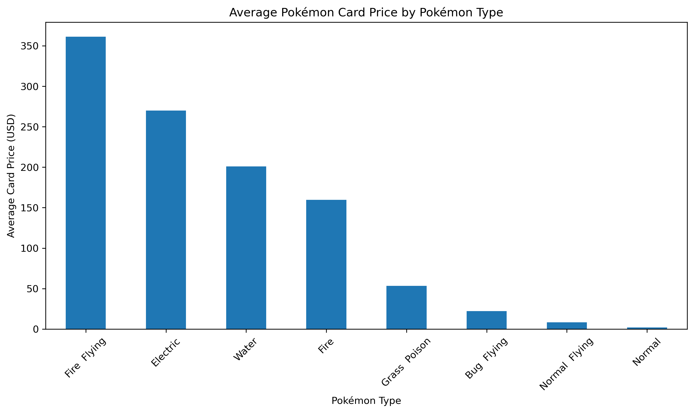
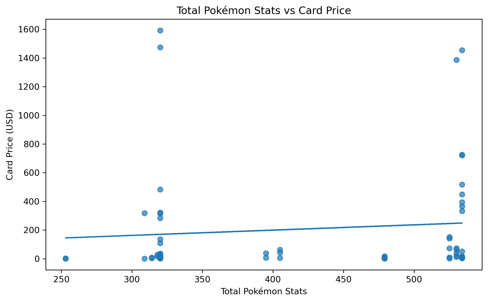
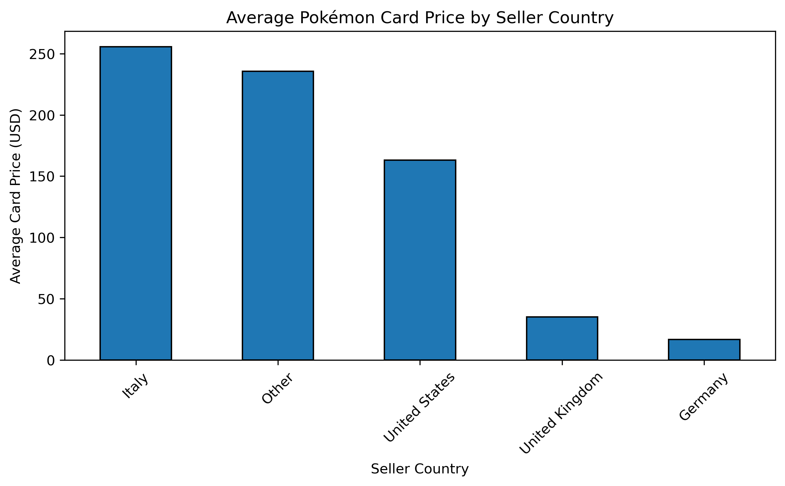

# Pokémon Market Analytics

Data analytics project integrating Pokémon statistics, PokéAPI data, and trading card marketplace pricing using Python, SQL, SQLite, and data visualization.

---

### Skills Demonstrated

- Data Cleaning & Preparation
- API Integration
- Web Data Extraction
- SQLite Database Construction
- SQL Joins
- Exploratory Data Analysis
- Data Visualization
- Analytical Reporting

## Project Files

- 📓 [Download Jupyter Notebook](Pokemon_Market_Analytics_SQL.ipynb)
- 🌐 [View HTML Notebook Export](https://htmlpreview.github.io/?https://github.com/stephfn/pokemon-market-analytics/blob/main/Pokemon_Market_Analytics_SQL.html)

## Project Overview

This project explores Pokémon trading card pricing by integrating game statistics, PokéAPI attributes, and marketplace data using Python and SQLite. The analysis demonstrates data cleaning, API retrieval, SQL joins, and exploratory visualization.

The final integrated dataset contained 60 records and nine variables. The findings are exploratory and describe associations within the available records rather than establishing the causes of card prices.
The project demonstrates an end-to-end data analytics workflow including:

- Data acquisition
- Data cleaning
- Database construction
- SQL integration
- Exploratory analysis
- Data visualization

---

## Project Visualizations

The following visualizations were generated from the final integrated SQLite dataset and highlight key relationships between Pokémon characteristics and marketplace pricing.

### Average Pokémon Card Price by Pokémon Type

**Key Finding:** Pokémon card rarity appeared to have a stronger influence on market value than Pokémon type alone.

### Total Pokémon Stats vs Card Price

**Key Finding:** Total battle statistics showed only a weak relationship with marketplace pricing, suggesting collectibility factors drive value more than competitive strength.

### Average Pokémon Card Price by Seller Country

**Key Finding:** Average card prices varied across seller regions, indicating differences in market demand, availability, and pricing behavior.

---

## Objectives

The primary goals of this project were to:

- Integrate multiple Pokémon-related datasets into a single analytical database
- Standardize and clean data collected from different sources
- Use SQLite and SQL joins to merge datasets
- Explore relationships between Pokémon characteristics and marketplace pricing
- Identify factors associated with card value and rarity
- Demonstrate practical data analytics and database management skills

---

## Data Sources

### Pokémon Statistics Dataset

Contains Pokémon battle statistics including:

- HP
- Attack
- Defense
- Speed
- Total Base Stats
- Pokémon Types

### PokéAPI

API-derived attributes including:

- Height
- Weight
- Base Experience

### Pokémon Trading Card Marketplace Data

Contains marketplace information including:

- Card Price
- Card Condition
- Seller Country
- Card Rarity

## Technologies Used

- Python
- Pandas
- NumPy
- SQLite
- SQL
- Requests
- Matplotlib
- Seaborn
- Jupyter Notebook

---

## SQL Database Integration

The cleaned datasets were loaded into SQLite as separate tables and merged using SQL INNER JOIN operations based on Pokémon names.

This integration created a consolidated analytical dataset combining:

- Pokémon statistics
- API attributes
- Marketplace pricing information

---
## Key Findings

- SQL INNER JOIN operations integrated Pokémon game statistics, API attributes, and trading card marketplace data.
- Average card prices differed across Pokémon types and rarity classifications in the analyzed dataset.
- The scatterplot suggested a weak positive relationship between total battle statistics and card price, with substantial variability.
- Average listing prices varied across seller countries, although these differences do not independently demonstrate geographic differences in demand.
- The dataset was limited in size and coverage, so the findings should be interpreted as exploratory rather than representative of the wider trading card market.

## Reproducibility and Limitations

The notebook uses live data retrieval from PokémonDB and PokéAPI alongside local CSV files, including `pokemon.csv` and `pokemon_cards_ultimate_2026.csv`. These CSV files are not currently included in the repository, so the full notebook cannot be reproduced from the repository alone.

The integrated dataset contains 60 records, and SQL INNER JOIN operations exclude records without matching Pokémon names across all three sources. Name-based matching may also be affected by alternate forms or naming differences.

Marketplace prices may depend on card edition, rarity, grading, condition, and other factors not fully controlled in this exploratory analysis. The visualizations should not be interpreted as evidence of causal relationships.
---

## Future Improvements

- Historical card price tracking
- Predictive card value modeling
- Interactive dashboards using Plotly or Streamlit
- Expanded marketplace datasets
- Time-series analysis of Pokémon card prices

---

### Reproducibility Note

This repository preserves a completed exploratory data analysis project, including the original Jupyter notebook, HTML export, SQL integration workflow, and generated visualizations.

Two source CSV files used in the original analysis are no longer available. Consequently, the complete notebook cannot currently be rerun from beginning to end. The published notebook and HTML export document the original methodology and results.

The project is retained as a demonstration of data cleaning, API integration, relational database operations, and exploratory analysis rather than as a fully reproducible analytical pipeline.

---

## Author

Stephanie Nord

Master's Student in Data Science

Bellevue University
